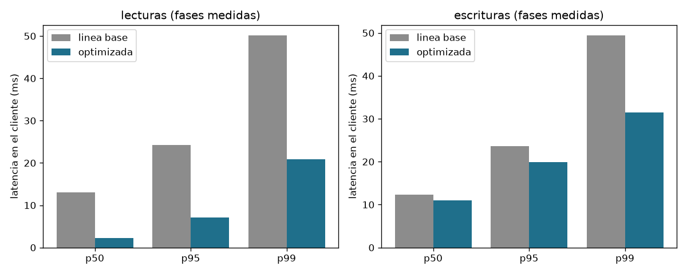
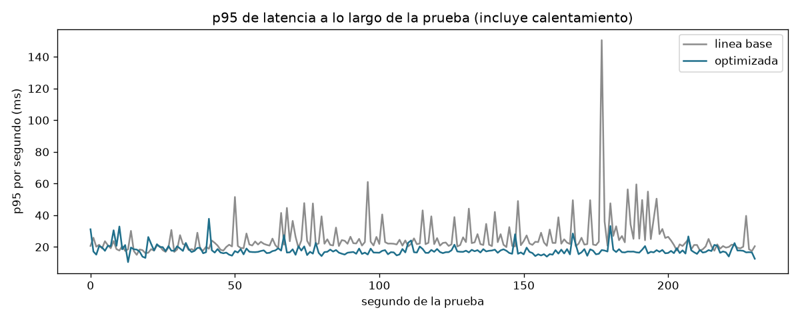

# Comparacion linea base vs. optimizada

- Linea base: `base-20261122-233109` (commit `af80239`, cache OFF)
- Optimizada: `opt-20261122-233914` (commit `af80239`, cache ON)
- Escenario: `pico-post-gol`, escala x1.0 / x1.0

## Condiciones

- Mismo escenario, mismo plan, misma escala, mismo cliente de Cassandra, misma maquina. Unica diferencia declarada: CACHE_COMENTARIOS_TTL_S (0 -> 2).

## Metricas (valores medidos, latencias en ms)

| Metrica | Linea base | Optimizada | Variacion | Mejor si |
|---|---:|---:|---:|---|
| [total medido] operaciones | 34310 | 35703 | +4.1% | mayor |
| [total medido] ops exitosas/s | 163.3 | 169.8 | +4.0% | mayor |
| [total medido] tasa de error | 0.0 | 0.0 |  | menor |
| [total medido] latencia cliente p50 (ms) | 12.87 | 2.89 | -77.5% | menor |
| [total medido] latencia cliente p95 (ms) | 24.04 | 17.23 | -28.3% | menor |
| [total medido] latencia cliente p99 (ms) | 49.91 | 24.89 | -50.1% | menor |
| [total medido] latencia cliente max (ms) | 186.25 | 48.98 | -73.7% | menor |
| [total medido] latencia API p95 (ms) | 21.9 | 16.02 | -26.8% | menor |
| [total medido] acierto de cache | None | 0.983 |  | mayor |
| [sostenimiento] operaciones | 22408 | 23300 | +4.0% | mayor |
| [sostenimiento] ops exitosas/s | 186.5 | 193.9 | +4.0% | mayor |
| [sostenimiento] tasa de error | 0.0 | 0.0 |  | menor |
| [sostenimiento] latencia cliente p50 (ms) | 12.76 | 2.83 | -77.8% | menor |
| [sostenimiento] latencia cliente p95 (ms) | 23.27 | 17.05 | -26.7% | menor |
| [sostenimiento] latencia cliente p99 (ms) | 48.91 | 24.98 | -48.9% | menor |
| [sostenimiento] latencia cliente max (ms) | 186.25 | 48.16 | -74.1% | menor |
| [sostenimiento] latencia API p95 (ms) | 21.32 | 15.92 | -25.3% | menor |
| [sostenimiento] acierto de cache | None | 0.9841 |  | mayor |
| [pico] operaciones | 5525 | 5831 | +5.5% | mayor |
| [pico] ops exitosas/s | 276.0 | 291.2 | +5.5% | mayor |
| [pico] tasa de error | 0.0 | 0.0 |  | menor |
| [pico] latencia cliente p50 (ms) | 15.41 | 3.23 | -79.0% | menor |
| [pico] latencia cliente p95 (ms) | 29.2 | 17.52 | -40.0% | menor |
| [pico] latencia cliente p99 (ms) | 61.59 | 25.95 | -57.9% | menor |
| [pico] latencia cliente max (ms) | 85.93 | 48.98 | -43.0% | menor |
| [pico] latencia API p95 (ms) | 26.01 | 16.03 | -38.4% | menor |
| [pico] acierto de cache | None | 0.99 |  | mayor |
| [lecturas] operaciones | 24122 | 25076 | +4.0% | mayor |
| [lecturas] ops exitosas/s | 114.8 | 119.3 | +3.9% | mayor |
| [lecturas] tasa de error | 0.0 | 0.0 |  | menor |
| [lecturas] latencia cliente p50 (ms) | 13.1 | 2.29 | -82.5% | menor |
| [lecturas] latencia cliente p95 (ms) | 24.23 | 7.05 | -70.9% | menor |
| [lecturas] latencia cliente p99 (ms) | 50.13 | 20.83 | -58.4% | menor |
| [lecturas] latencia cliente max (ms) | 186.25 | 46.51 | -75.0% | menor |
| [lecturas] latencia API p95 (ms) | 22.14 | 5.44 | -75.4% | menor |
| [lecturas] acierto de cache | None | 0.983 |  | mayor |
| [escrituras] operaciones | 10188 | 10627 | +4.3% | mayor |
| [escrituras] ops exitosas/s | 48.5 | 50.5 | +4.1% | mayor |
| [escrituras] tasa de error | 0.0 | 0.0 |  | menor |
| [escrituras] latencia cliente p50 (ms) | 12.36 | 11.04 | -10.7% | menor |
| [escrituras] latencia cliente p95 (ms) | 23.56 | 19.91 | -15.5% | menor |
| [escrituras] latencia cliente p99 (ms) | 49.4 | 31.53 | -36.2% | menor |
| [escrituras] latencia cliente max (ms) | 179.63 | 48.98 | -72.7% | menor |
| [escrituras] latencia API p95 (ms) | 21.23 | 18.68 | -12.0% | menor |
| [escrituras] acierto de cache | None | None |  | mayor |
| lecturas que llegaron a Cassandra (nodetool) | 24469.0 | 456.0 | -98.1% | menor |
| escrituras que llegaron a Cassandra (nodetool) | 10322.0 | 10762.0 | +4.3% | - |
| recurso api_cpu_pct (promedio) | 34.2 | 28.4 | -17.0% | - |
| recurso api_cpu_pct (max) | 60.8 | 49.4 | -18.7% | - |
| recurso api_rss_mib (promedio) | 121.0 | 115.3 | -4.7% | - |
| recurso api_rss_mib (max) | 126.3 | 118.0 | -6.6% | - |
| recurso cassandra_cpu_pct (promedio) | 42.2 | 22.8 | -46.0% | - |
| recurso cassandra_cpu_pct (max) | 107.7 | 181.8 | +68.8% | - |
| recurso cassandra_mem_mib (promedio) | 4775.9 | 4773.7 | -0.0% | - |
| recurso cassandra_mem_mib (max) | 4798.5 | 4799.5 | +0.0% | - |
| recurso generador_cpu_pct (promedio) | 5.8 | 5.8 | +0.0% | - |
| recurso generador_cpu_pct (max) | 10.5 | 9.6 | -8.6% | - |
| recurso host_cpu_pct (promedio) | 17.2 | 11.0 | -36.0% | - |
| recurso host_cpu_pct (max) | 24.6 | 18.2 | -26.0% | - |
| recurso host_mem_pct (promedio) | 75.7 | 75.2 | -0.7% | - |
| recurso host_mem_pct (max) | 76.9 | 76.2 | -0.9% | - |
| recurso redis_cpu_pct (promedio) | 0.5 | 1.3 | +160.0% | - |
| recurso redis_cpu_pct (max) | 3.6 | 4.3 | +19.4% | - |
| recurso redis_mem_mib (promedio) | 7.2 | 7.8 | +8.3% | - |
| recurso redis_mem_mib (max) | 7.7 | 8.6 | +11.7% | - |
| redis evicted_keys durante la prueba | 0.0 | 0.0 |  | menor |
| redis memoria usada despues | 1.43M | 1.51M |  | - |

## Integridad

| Control | Linea base | Optimizada |
|---|---|---|
| veredicto | OK | OK |
| escrituras_aceptadas_201 | 10322 | 10762 |
| perdidos | 0 | 0 |
| alterados | 0 | 0 |
| escritos_sin_confirmacion | 0 | 0 |
| duplicados_por_reintento | {'ids': 707, 'filas_extra': 737} | {'ids': 735, 'filas_extra': 765} |
| duplicados_inesperados | {'ids': 0, 'filas_extra': 0} | {'ids': 0, 'filas_extra': 0} |

## Graficos

