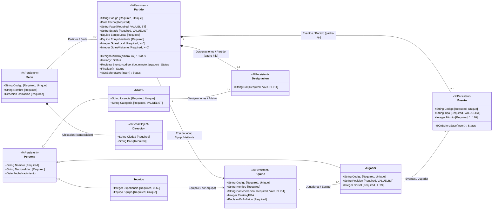

# Hito 9 — Entidades complejas del Fixture 2030 (InterSystems IRIS)

**Repositorio del grupo:** https://github.com/franreyna6/ing-de-datos-2 (carpeta `iris/`)

Ingeniería de Datos II · Grupo 8 · Fixture Mundial 2030 · Clase 10 (bases orientadas a objetos)

Módulo que modela el **Partido** como entidad compleja con clases persistentes de **InterSystems IRIS Community** en Docker. Un partido es una máquina de estados (`Programado → EnJuego → Finalizado`) que es dueña de sus **eventos** (goles y tarjetas, inalterables) y de su **terna arbitral**; las personas del torneo (jugadores, árbitros y técnicos) comparten una clase base. Las reglas viven dentro de las clases, sin ORM ni capa intermedia, y los mismos datos se consultan como objetos y como tablas SQL.

> **Alcance.** Se modela solo la porción del dominio que necesita identidad, reglas de estado y composición: partido, eventos, designaciones arbitrales, personas, equipos y sedes. Comentarios (Cassandra, Hito 6), sesiones (Redis, Hito 7) y estadísticas en vivo (InfluxDB, Hito 8) quedan en sus módulos. Partidos, equipos, jugadores, sedes y eventos salen de los CSV del Hito 5; árbitros y técnicos no existen en esos CSV y se generan de forma determinista (datos simulados). El laboratorio es una instancia local: demuestra la **corrección** del modelo, no el rendimiento de producción.

## Requisitos previos

- Docker (Docker Desktop en Windows o macOS) con `docker compose`.
- Puertos `1972` y `52773` libres en `127.0.0.1`.
- No hace falta Python ni otro lenguaje: todo corre dentro de IRIS.

## Inicio rápido

Desde la carpeta `iris/`:

```bash
# Linux, macOS o Windows con WSL (ver la nota de Windows)
./scripts/ejecutar_todo.sh
./scripts/ejecutar_todo.sh --probar-persistencia   # además recrea el contenedor y recuenta
./scripts/ejecutar_todo.sh --reiniciar             # borra el dominio y recarga desde cero
```

> **Windows.** IRIS, al iniciar, ejecuta `chown irisowner /durable` sobre el directorio durable. Si `~/docker/data/iris` es una carpeta del disco de Windows (`C:\Users\...`, NTFS), ese `chown` falla (`ERROR #5001: Error executing chown irisowner:irisowner /durable/`) y la instancia no arranca: el contenedor queda *unhealthy* e `iris qlist` dice `down`. Hay dos salidas:
>
> 1. **Sin instalar nada (PowerShell):** `.\scripts\ejecutar_todo.ps1 -VolumenDocker -ProbarPersistencia`. Suma `docker-compose.windows.yml`, que monta `/durable` en el volumen de Docker `fixture2030-iris-durable`. Vive en el disco Linux de Docker Desktop, donde el `chown` funciona, y persiste igual: sobrevive a `docker compose down` y a recrear el contenedor (lo prueba `-ProbarPersistencia`). Es un **desvío justificado** de la ruta `~/docker/data/iris` (RNF1), forzado por el sistema de archivos de Windows; en Linux o macOS se usa el compose original sin cambios.
> 2. **Respetando la ruta literal:** ejecutar `./scripts/ejecutar_todo.sh` desde una terminal de **WSL (Ubuntu)**, donde `~` es `/home/<usuario>` en un sistema de archivos Linux (Docker Desktop → *Settings → Resources → WSL integration*; la carpeta del repo se ve como `/mnt/c/Users/<usuario>/...`).
>
> Antes de cualquiera de las dos, `docker compose down` si quedó un contenedor de un intento fallido.

El script levanta el contenedor, espera a IRIS, compila las clases, carga los datos y ejecuta los siete bloques de demostración, cada uno en una sesión nueva del Terminal. Todo queda en `docs/evidencia/logs/ejecucion_<fecha>.log`.

## Operativa paso a paso (sin el script)

1. **Directorio durable y contenedor** (instructivo de la Clase 10):
   ```bash
   mkdir -p ~/docker/data/iris
   sudo chown -R "$(id -u):$(id -g)" ~/docker/data/iris    # Linux
   sudo chmod -R 777 ~/docker/data/iris                    # Linux
   docker compose up -d
   docker compose ps
   docker compose logs -f iris        # esperar a que termine el primer inicio
   ```
   En Windows, estos comandos se ejecutan en una terminal de WSL (ver la nota de Windows en *Inicio rápido*): con el directorio durable en el disco de Windows IRIS no puede hacer `chown` y no arranca.
2. **Abrir el Terminal de IRIS** (namespace `USER`):
   ```bash
   docker exec -it fixture2030-iris iris session IRIS -U USER
   ```
3. **Cargar y compilar las clases** (`docker-compose.yml` monta `src/` en `/iris/src`):
   ```objectscript
   Set sc = $system.OBJ.LoadDir("/iris/src","ck",.err,1)
   Write $System.Status.IsOK(sc)
   ```
   `LoadDir` carga todos los `.cls` y los compila juntos (flag `c`), lo necesario porque cada relación declara su inversa en la otra clase.
4. **Cargar los datos** (idempotente: si ya están, no duplica):
   ```objectscript
   Do ##class(Fixture.Carga).Todo()
   ```
5. **Ejecutar los bloques de demostración**, uno por vez:
   ```objectscript
   Do ##class(Fixture.Demo).Bloque2ArbolAtomico()     // RF6
   Do ##class(Fixture.Demo).Bloque3FalloControlado()  // RF5
   Do ##class(Fixture.Demo).Bloque4Navegacion()       // RF7
   Do ##class(Fixture.Demo).Bloque5ProyeccionSQL()    // RF8
   Do ##class(Fixture.Demo).Bloque6Validaciones()     // RF9
   Do ##class(Fixture.Demo).Bloque7Integridad()       // RF3 + matriz
   ```
   Conviene ejecutar cada bloque en una sesión nueva (`Halt` y volver a entrar), como hace el script: un árbol rechazado queda en la memoria del proceso y no debe mezclarse con el guardado de otro.
6. **Comandos sueltos para escribir a mano**: [`scripts/demo_terminal.txt`](scripts/demo_terminal.txt) tiene el bloque estructurado de la sección 5.3 (padre + hijo con un solo `%Save()`, fallo por requerido omitido, navegación y SQL) sin depender de `Fixture.Demo`.
7. **SQL**: `Do $system.SQL.Shell()` en el Terminal, o el Management Portal en `http://localhost:52773/csp/sys/UtilHome.csp` → *System Explorer → SQL* (namespace `USER`, esquema `Fixture`). La imagen Community pide cambiar la contraseña predeterminada en el primer ingreso; no se versiona ninguna credencial.
8. **Detener sin perder datos:**
   ```bash
   docker compose stop     # detiene
   docker compose down     # quita el contenedor; los datos quedan en ~/docker/data/iris
   docker compose up -d    # vuelve con los mismos datos (no hace falta recompilar ni recargar)
   ```

## Diagrama de objetos



Cada relación es **bidireccional**: se declara en las dos clases con `Relationship ... [ Cardinality = ..., Inverse = ... ]` y se navega en ambos sentidos (`partido.Eventos` y `evento.Partido`). Los motivos de cada decisión (entidad, componente, relación o herencia), los índices y los tipos están en [`docs/modelo_de_objetos.md`](docs/modelo_de_objetos.md).

## Matriz de integridad (resumen)

| Operación | Qué pasa con los relacionados | Mecanismo |
| :--- | :--- | :--- |
| Borrar un **Partido** | Se borran **en cascada** sus Eventos y Designaciones | Relación padre-hijo (`children`/`parent`) |
| Borrar un **Jugador** con eventos | **Se rechaza**; el jugador sigue existiendo | Relación uno-a-muchos Jugador–Evento |
| Borrar una **Sede** con partidos | **Se rechaza** | Relación uno-a-muchos Sede–Partido |
| Borrar un **Árbitro** con designaciones | **Se rechaza** | Relación uno-a-muchos Árbitro–Designación |
| Borrar un **Equipo** con jugadores | **Se rechaza** | Relación uno-a-muchos Equipo–Jugador |
| Guardar un árbol con un hijo inválido | **No se guarda nada** (ni padre ni hermanos válidos) | `%Save()` transaccional del grafo alcanzable |
| Modificar un Evento guardado | **Se rechaza** | `Evento.%OnBeforeSave()` |
| Registrar un evento fuera de `EnJuego` | **Se rechaza** | `Partido.RegistrarEvento()` |
| Cambiar el marcador o el estado sin los métodos | **Se rechaza** al guardar | `Partido.%OnBeforeSave()` |

La matriz completa, con los límites (qué **no** protege el modelo, por ejemplo una escritura SQL directa), está en [`docs/matriz_de_integridad.md`](docs/matriz_de_integridad.md).

## Trazabilidad de requisitos

| Req. | Dónde se cumple | Cómo se demuestra |
| :--- | :--- | :--- |
| RF1 / RNF1 | `docker-compose.yml`: `intersystems/iris-community:latest-cd`, `ISC_DATA_DIRECTORY=/durable` en `~/docker/data/iris` (en Windows, volumen de Docker; ver la nota de Windows) | Pasos 0–1c del log; prueba `-ProbarPersistencia` |
| RF2 | Diez clases de dominio en `src/Fixture/` (nueve persistentes y un componente embebido) | Compilación (paso 2 del log) |
| RF3 | Padre-hijo Partido–Evento y Partido–Designación; uno-a-muchos Sede–Partido, Equipo–Jugador, Jugador–Evento, Árbitro–Designación | Bloques 4 (navegación en ambos sentidos) y 7 (borrados) |
| RF4 | `Persona` → `Jugador`, `Arbitro`, `Tecnico` | Bloque 4 (polimorfismo) y Bloque 5 (`Fixture.Persona` en SQL) |
| RF5 | `[ Required ]`, `VALUELIST`, `MINVAL`/`MAXVAL`, `MAXLEN`, `%Date`, `%Boolean` | Bloque 3 (requerido omitido) y Bloque 6 |
| RF6 | `Fixture.Carga.Partidos()` y `Fixture.Demo.Bloque2ArbolAtomico()` | IDs vacíos antes y asignados después de un solo `%Save()` |
| RF7 | `Fixture.Demo.Bloque4Navegacion()` | Recorrido partido → sede → dirección → árbitros → eventos → jugador → equipo, sin SQL |
| RF8 | Proyección automática de las clases a tablas `Fixture.*` | Bloque 5: mismos IDs y valores por SQL, `UPDATE` por SQL leído por objetos |
| RF9 | `DesignarArbitro`, `Iniciar`, `RegistrarEvento`, `Finalizar`, `%OnBeforeSave` | Bloque 6: gol en el minuto 0 sobre un partido Finalizado, y otras transiciones |
| RNF2 | Compilación con `LoadDir(..., "ck")` sin dependencias externas | Paso 2 del log: `COMPILACION: OK` |
| RNF3 | Índice sobre cada propiedad relacional del lado muchos/hijo | `Evento.PartidoIdx`, `Evento.JugadorIdx`, `Designacion.PartidoIdx`, `Designacion.ArbitroIdx`, `Jugador.JugEquipoIdx`, `Partido.SedeIdx` |
| RNF4 | Todo en `.cls`, invocable desde el Terminal | `Do ##class(Fixture.Demo).BloqueN...()` |
| RNF5 | Este repositorio, carpeta `iris/` | Historial de commits del grupo |

## Código fuente del dominio

```
iris/
├── docker-compose.yml         # IRIS Community, Durable %SYS en ~/docker/data/iris
├── docker-compose.windows.yml # solo Windows: Durable %SYS en un volumen de Docker (chown sobre NTFS falla)
├── .gitignore                 # sin datos ni binarios de la instancia
├── README.md
├── data/origen/               # CSV del Hito 5 (sedes, equipos, jugadores, partidos, participaciones, eventos)
├── src/Fixture/
│   ├── Persona.cls            # clase base (herencia)
│   ├── Jugador.cls            # Persona + posición, dorsal, equipo, eventos
│   ├── Arbitro.cls            # Persona + licencia, designaciones
│   ├── Tecnico.cls            # Persona + experiencia, equipo (uno por equipo)
│   ├── Equipo.cls             # selección; uno-a-muchos con Jugador
│   ├── Sede.cls               # estadio; contiene Direccion; uno-a-muchos con Partido
│   ├── Direccion.cls          # %SerialObject (composición)
│   ├── Partido.cls            # entidad compleja: estados, reglas, hijos
│   ├── Evento.cls             # hijo de Partido; inalterable
│   ├── Designacion.cls        # hijo de Partido; árbitro + rol
│   ├── Carga.cls              # carga inicial desde los CSV (RF6)
│   └── Demo.cls               # bloques de demostración invocables desde el Terminal
├── scripts/
│   ├── ejecutar_todo.ps1      # flujo completo en Windows, con log
│   ├── ejecutar_todo.sh       # flujo completo en Linux/macOS, con log
│   └── demo_terminal.txt      # comandos para escribir a mano en el Terminal
└── docs/
    ├── modelo_de_objetos.md   # decisiones: entidad, componente, relación, herencia, índices
    ├── matriz_de_integridad.md# reglas de integridad, qué protege cada una y límites
    └── evidencia/
        ├── README.md          # qué capturas tomar y qué debe verse en cada una
        └── logs/              # salida de cada corrida
```

## Evidencia de ejecución

La evidencia se genera corriendo el script: el log de la corrida (`docs/evidencia/logs/`) contiene la compilación, los conteos de la carga y cada operación con su resultado (`[ACEPTADO]` o `[RECHAZADO]` y el motivo que devuelve IRIS). Cada verificación se calcula consultando la base, de modo que lo que se declara en este README coincide con lo que se ejecuta. La lista de capturas del Terminal y del Portal, y qué debe verse en cada una, está en [`docs/evidencia/README.md`](docs/evidencia/README.md).
