# Evidencia — consultas y visualización (RF11)

Capturas de Neo4j Browser correspondientes a la carga, la verificación de idempotencia,
las operaciones CRUD, los recorridos de grafo, el análisis relacional (RF9) y la
visualización del subgrafo.

## 1. Carga (queries/carga.cypher)
Conteo final esperado: equipos=64, jugadores=1024, sedes=12, partidos=96, eventos=437.
Total de nodos y relaciones: 1633 nodos, 2186 relaciones.

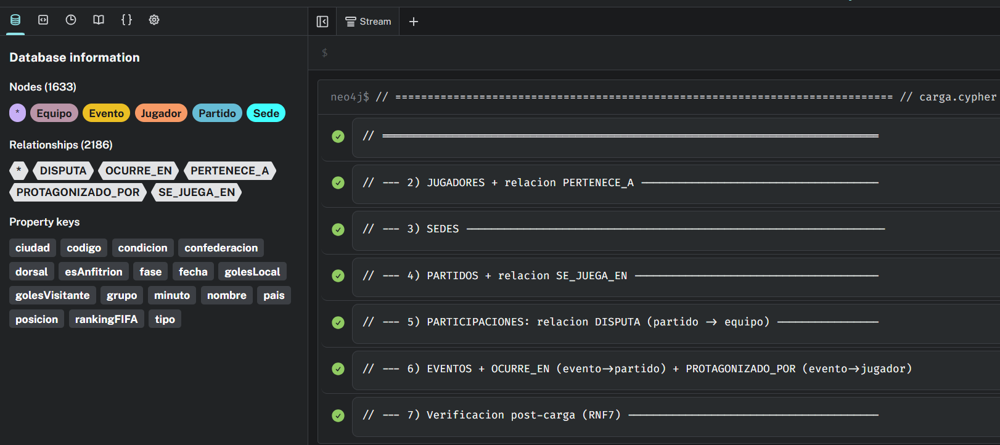

## 2. Idempotencia (RNF4)
Se volvió a ejecutar `carga.cypher` por segunda vez. Los conteos se mantienen exactamente
iguales (1633 nodos, 2186 relaciones), lo que confirma que el uso de `MERGE` evita duplicados.

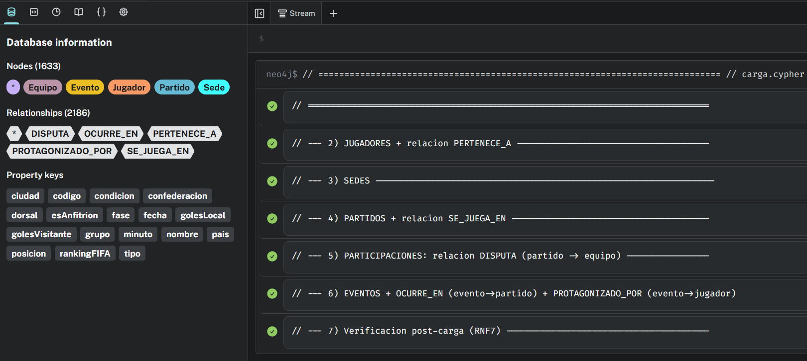

## 3. CRUD (queries/crud.cypher)

**CREATE** — alta de un evento de prueba (asistencia) vinculado a un partido y un jugador:

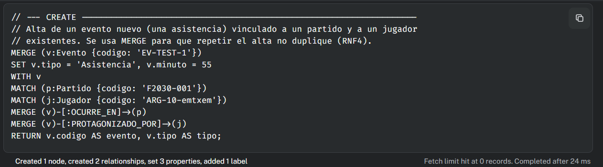

**READ** — recuperación del evento recién creado con su contexto:

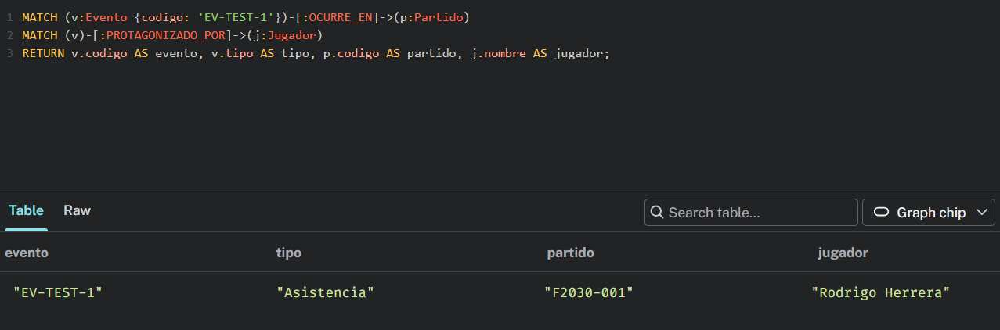

**UPDATE** — corrección del minuto del evento de prueba:

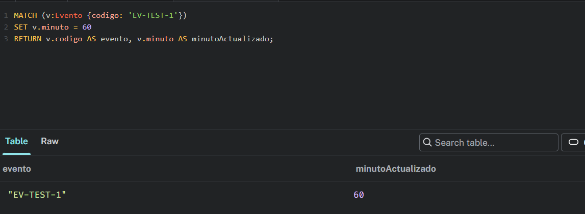

**UPDATE** — lectura de una propiedad de relación (condición local/visitante):

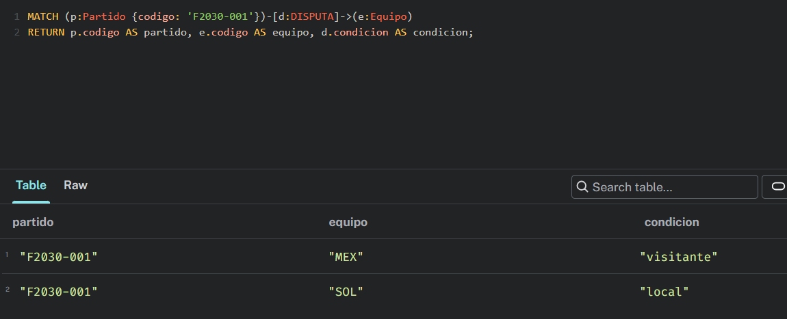

**DELETE** — eliminación acotada de la relación del evento de prueba:

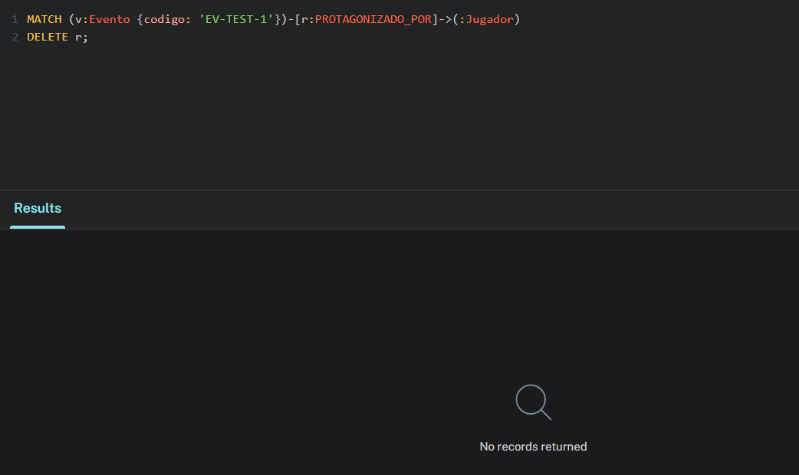

**DELETE** — eliminación acotada del nodo de prueba (DETACH DELETE por código):

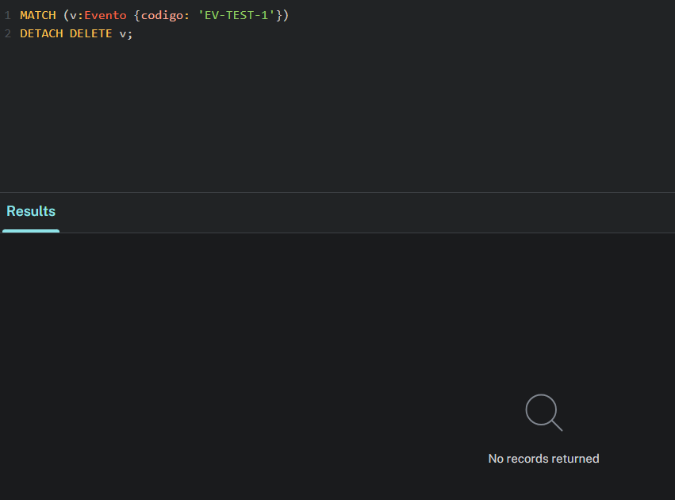

**Verificación** — el evento de prueba ya no existe (0 resultados, como se esperaba):

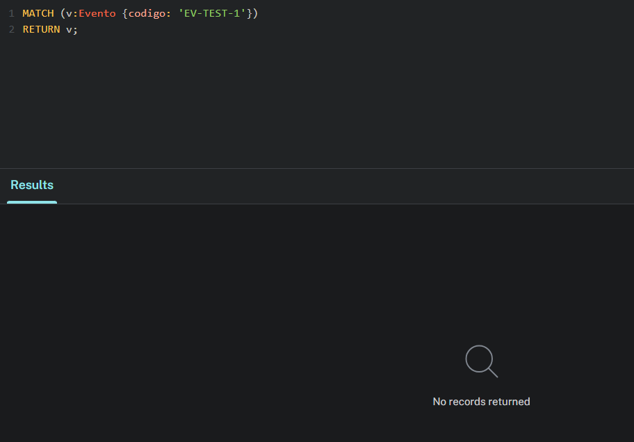

## 4. Recorridos de 2+ saltos (queries/consultas_grafo.cypher, sección B)

**A.1** — Plantel de una selección (Argentina), ordenado por dorsal:

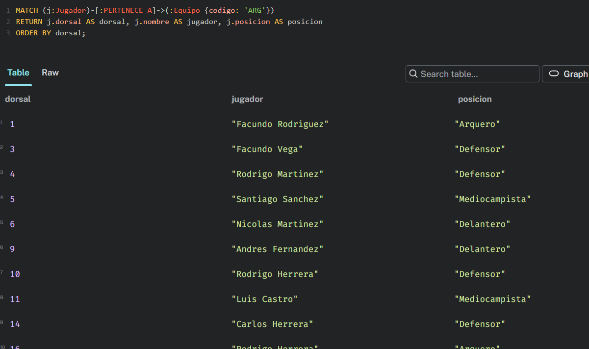

**A.2** — Partidos de un grupo con su sede:

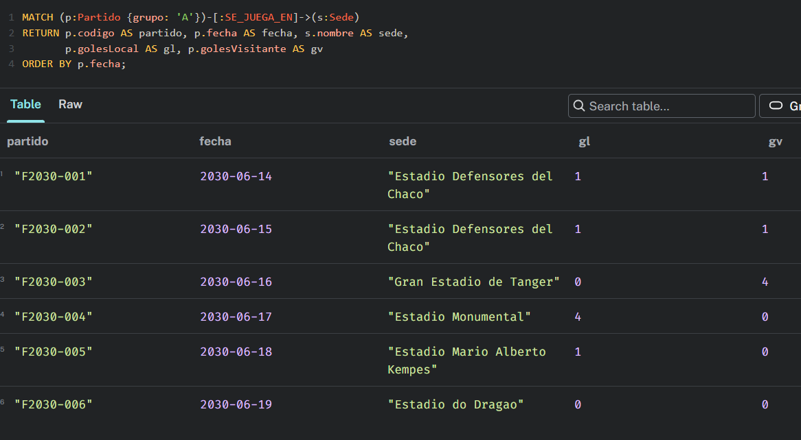

**B.1** — Recorrido de 4 relaciones: goles con autor, selección, partido y sede:

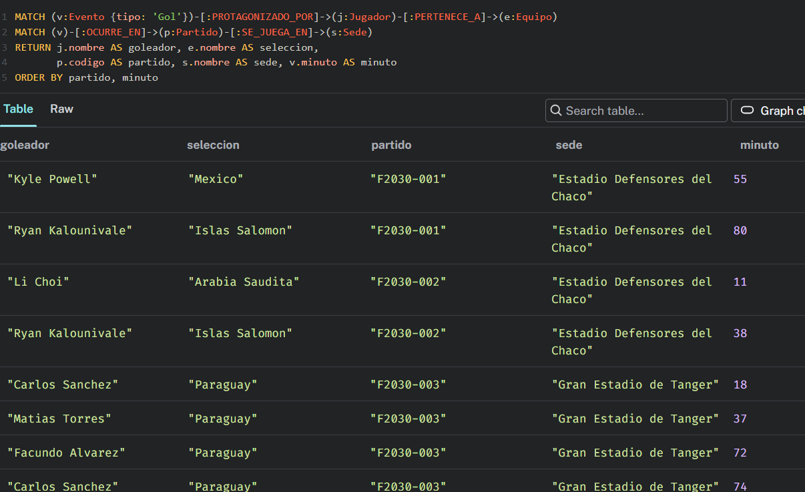

**B.2** — Recorrido de 2 relaciones: máximos goleadores del torneo:

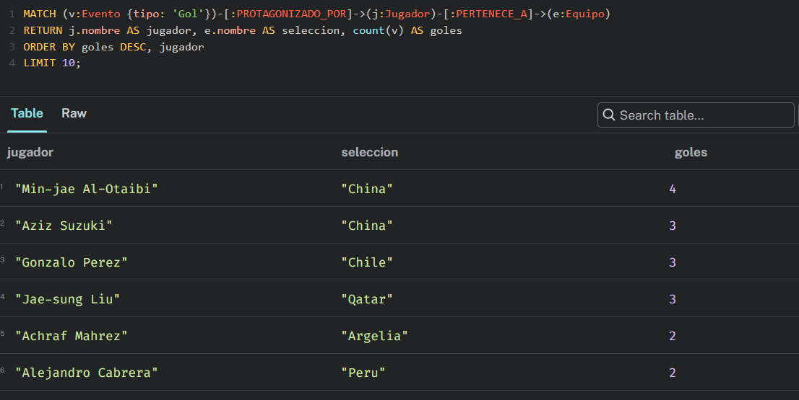

**B.3** — Recorrido de 2 relaciones: rivales de Argentina en la fase de grupos:

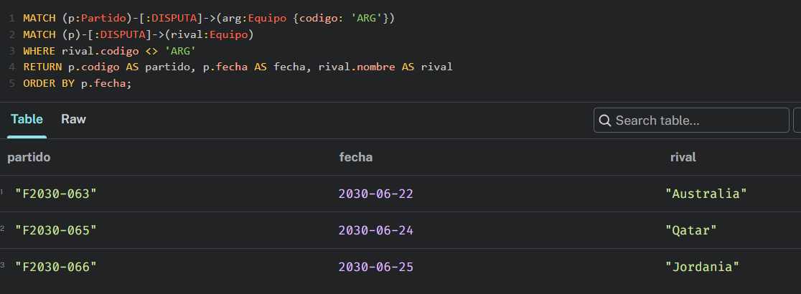

## 5. Análisis RF9 — centralidad de sedes y conectividad (sección C)

**C.1** — Centralidad por grado: sede que concentra más partidos:

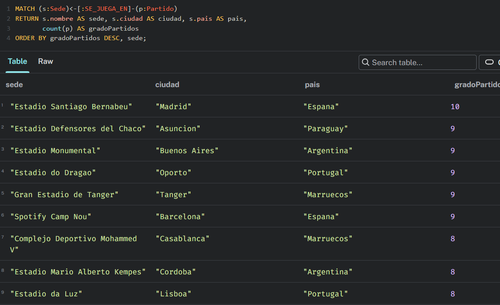

**C.2** — Conectividad indirecta: equipos vinculados a Argentina por sede compartida:

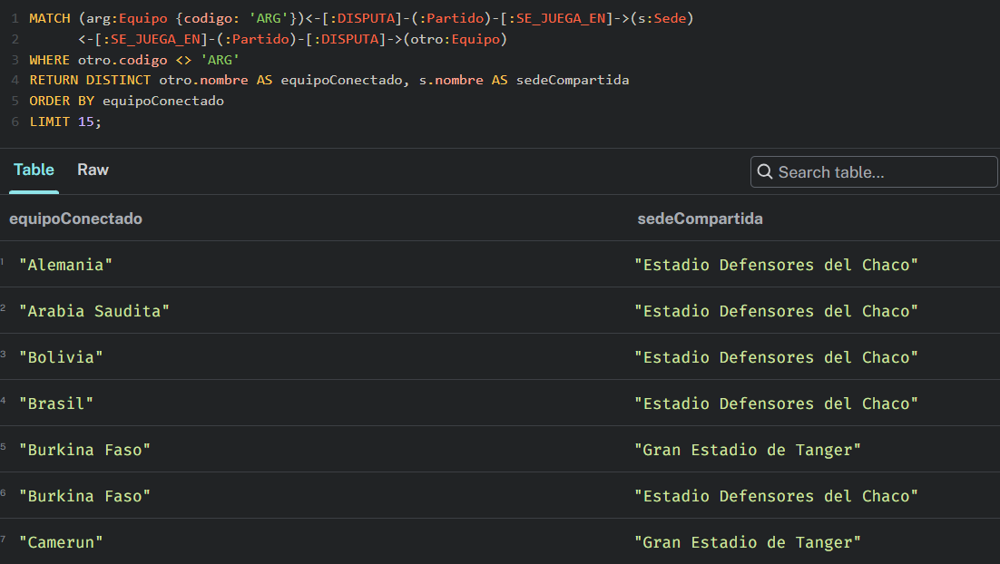

## 6. Visualización del subgrafo (RF11)

Vista de grafo (nodos + relaciones) de los equipos del Grupo A, sus partidos, sedes y
planteles. Panel de resultados: 50 nodos, 49 relaciones (DISPUTA, PERTENECE_A, SE_JUEGA_EN).

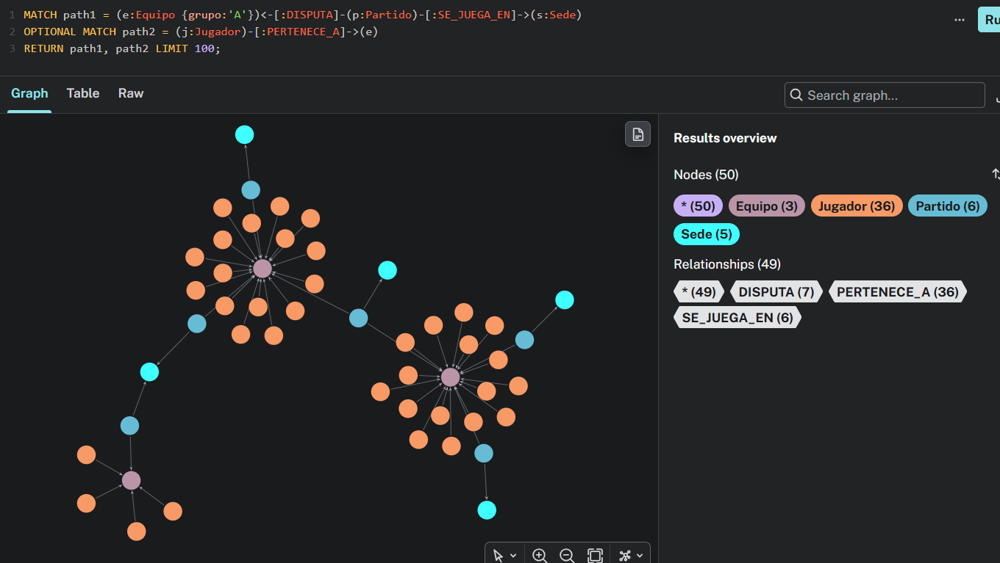