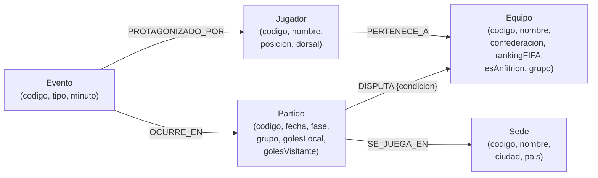

# Modelo del subgrafo — Fixture 2030 (Hito 5)

**Grupo 8** · Neo4j

## Diagrama

## Nodos (etiquetas y propiedades)

| Etiqueta | Identificador | Propiedades | Justificación |
| :--- | :--- | :--- | :--- |
| `Equipo` | `codigo` (FIFA, p. ej. `ARG`) | `nombre`, `confederacion`, `rankingFIFA`, `esAnfitrion`, `grupo` | Mismo `codigo` que el Hito 4 (RF5). Solo propiedades identificatorias y de navegación; la ficha completa vive en Mongo. |
| `Jugador` | `codigo` (p. ej. `ARG-10-emtxem`) | `nombre`, `posicion`, `dorsal` | Mismo `codigo` que el Hito 4 (RF5). Sin `valorMercado`/`goles`/`altura` (esos datos son del documento, no del grafo). |
| `Partido` | `codigo` (p. ej. `F2030-001`) | `fecha`, `fase`, `grupo`, `golesLocal`, `golesVisitante` | Entidad propia del fixture: articula equipos, sede y eventos. |
| `Sede` | `codigo` (p. ej. `BERN`) | `nombre`, `ciudad`, `pais` | Estadios de los 6 países anfitriones. |
| `Evento` | `codigo` (p. ej. `EV-0001`) | `tipo` (Gol/Tarjeta), `minuto` | Hecho deportivo dentro de un partido; nodo propio para poder recorrerlo. |

## Relaciones (tipo, dirección, cardinalidad)

| Relación | Dirección | Cardinalidad | Significado |
| :--- | :--- | :--- | :--- |
| `PERTENECE_A` | `(Jugador)→(Equipo)` | N:1 | Un jugador pertenece a una selección; una selección tiene muchos jugadores. |
| `DISPUTA` | `(Partido)→(Equipo)` | N:2 (propiedad `condicion`: local/visitante) | Un partido enfrenta a dos equipos; un equipo disputa varios partidos. |
| `SE_JUEGA_EN` | `(Partido)→(Sede)` | N:1 | Un partido se programa en una sede; una sede alberga varios partidos. |
| `OCURRE_EN` | `(Evento)→(Partido)` | N:1 | Un evento pertenece a un partido; un partido tiene varios eventos. |
| `PROTAGONIZADO_POR` | `(Evento)→(Jugador)` | N:1 | Un evento (gol/tarjeta) tiene un protagonista. |

La dirección de `PERTENECE_A`, `DISPUTA` y `SE_JUEGA_EN` sigue la convención presentada en la Clase 5.

## Recorridos que habilita el modelo

- Plantel → equipo → partidos → sedes (3 saltos): logística de un plantel.
- Evento(Gol) → jugador → equipo (2 saltos): tabla de goleadores.
- Partido → equipo A / equipo B (2 saltos): rivales de una selección.
- Equipo ← partido → sede ← partido → equipo: conectividad entre selecciones por sede compartida.
